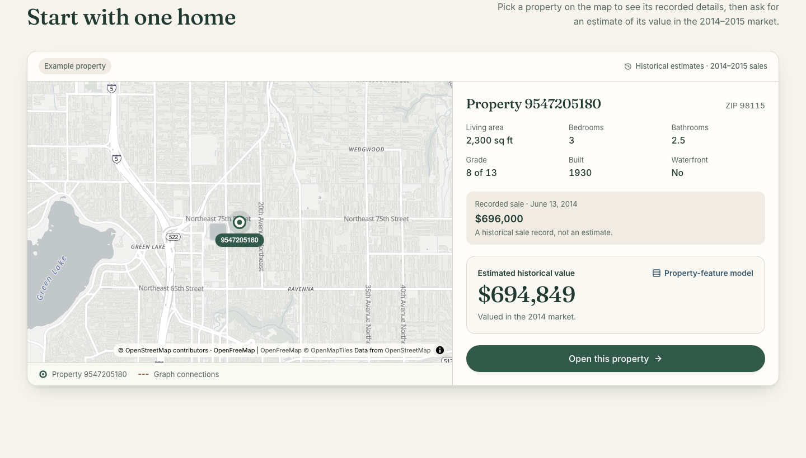
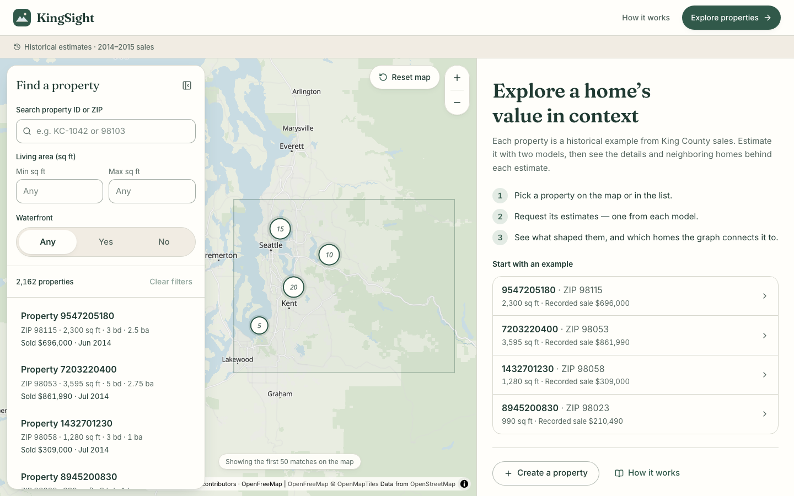
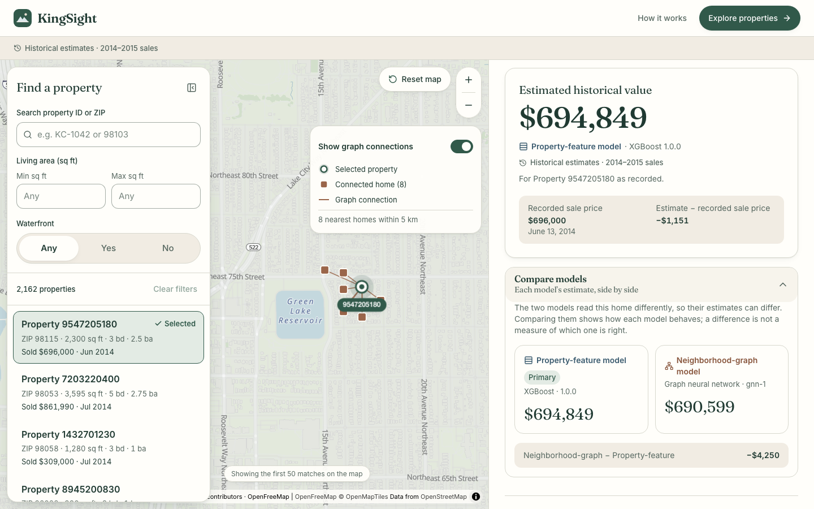
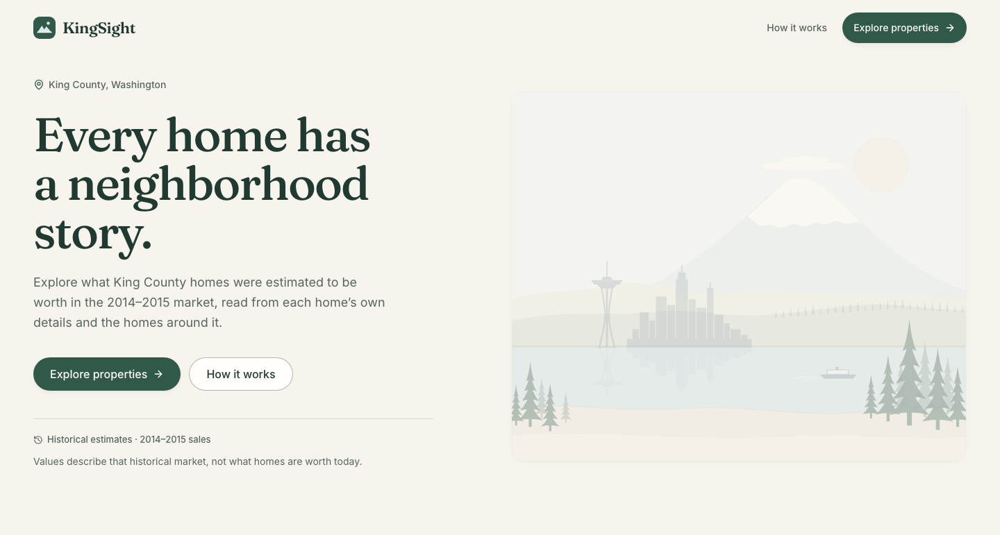

# KingSight

KingSight estimates what King County homes were worth in the May 2014–May 2015 sales market. A map shows the homes. Two models estimate each one: a property-feature model that reads the home itself, and a neighborhood-graph model that also reads nearby homes. The results are historical estimates, not today’s prices.

## Features

**A recorded sale, then a historical estimate.** The landing preview opens on a real King County home, with its sale record beside an estimate from the property-feature model.



**The county, on a map.** The explorer lists held-out sales and plots them on OpenStreetMap. Filters for the list and the map stay in step.



**Two models, and the homes the graph used.** Compare the property-feature estimate with the neighborhood-graph estimate, then see which nearby homes the graph connected.



The landing page introduces the same historical market:



- Estimates use US dollars and square feet, and they are labeled as 2014–2015 sales.
- Homes are identified by dataset id, ZIP, and coordinates. The app does not show street addresses.
- Feature contributions describe model behavior. Connected homes are graph context, not comparable sales.
- A hypothetical home says which fields were imputed.

## Getting Started

You need Python 3.13+, [uv](https://docs.astral.sh/uv/), and Node.js.

```bash
uv sync
PYTHONPATH=src uv run python scripts/export_catalog.py
PYTHONPATH=src uv run uvicorn kingsight.api.main:app --reload --port 8000
```

In another terminal:

```bash
cd app
npm install
VITE_DATA_MODE=api VITE_API_BASE_URL=http://127.0.0.1:8000 npm run dev
```

Open [http://127.0.0.1:5173](http://127.0.0.1:5173). The API allows that origin and `http://localhost:5173`.

The source CSVs, the train/validation/test split, the scaler, and the trained XGBoost and graph models are already in the repository. `export_catalog.py` builds the local SQLite catalog the API reads. It does not retrain the models.

To run the interface without the API, skip the Python commands and use `cd app && npm install && npm run dev`. That mode uses built-in demo properties.

## Acknowledgements

- Sales come from the [House Sales in King County](https://www.kaggle.com/datasets/harlfoxem/housesalesprediction) dataset published on Kaggle by harlfoxem. KingSight uses the May 2014–May 2015 sales in that file.
- The basemap is [OpenFreeMap](https://openfreemap.org/) Positron, built from [OpenStreetMap](https://www.openstreetmap.org/copyright) data. © OpenStreetMap contributors.
- Property-feature estimates use [XGBoost](https://xgboost.readthedocs.io/). Neighborhood-graph estimates use a small message-passing model on [PyTorch](https://pytorch.org/).
